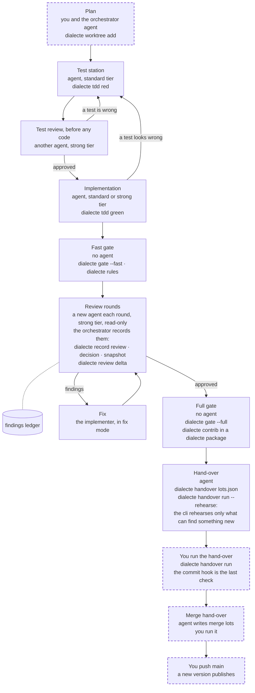

# Delivering a change with agents

Most changes to the Dialecte packages are written by coding agents. This page explains, for the
person who works with them, how a change goes from a plan to a published version: the steps, who acts
at each one, which `dialecte` command runs, and where you come in.

Everything on this page needs `@dialecte/cli` 0.2.0 or later; the commit hook's reuse of a green full gate needs 0.2.1, `dialecte contrib` 0.3.0.

The rule behind every step: **agents prepare, the person commits.** No agent commits, stages, pushes
or publishes. Every commit is yours, and you make it by running one command.

## Words used on this page

- A **lot** is the smallest change worth landing on its own: it builds, it is tested, documented and
  reviewed. A larger change is cut into several lots.
- A **station** is one step of the work with one job, done by one agent (or by a command, with no agent).
  Each station reads only what it is given and leaves a file behind for the next one.
- A **gate** is a set of checks that must pass before the work moves on: type-check, lint, format,
  tests, build, documentation. The cli runs them and records the counts they print.
- A **round** is one pass of an independent review. Each round is a new agent that did not write the
  code and did not see the earlier verdicts.
- A **hand-over** is a folder the agent prepares outside the repository. It holds the list of commits
  to make, a snapshot of the files as they were reviewed, and a card that sums up the checks. You read
  the card, then run one command that makes the commits.
- The **orchestrator** is the agent that plans the lot with you, writes the brief of each station,
  starts the other agents and keeps the review's records.
- A **tier** is the kind of model an agent runs on: `standard` for work that is fully specified,
  `strong` for review and design. `npx @dialecte/cli models` says which model each tier means for
  your vendor.
- **Red** and **green**: a test is red when it fails and green when it passes. A new test must be seen
  red before the code exists, then green with the code. The cli keeps a **receipt** of each, so the
  order can be checked later.
- A **rehearsal** runs the commits of a hand-over in a scratch copy of the repository, with its real
  commit hook, to find a failure before you run it for real. Your repository is not touched.

## The pipeline

Each box names who acts and the command that runs. Dashed boxes are yours.



The same steps in a table:

| Step            | Who acts                                                                                                     | Command                                                                                                                                          | What it records                                                                                              | What can block it                                                                                                                                                             |
| --------------- | ------------------------------------------------------------------------------------------------------------ | ------------------------------------------------------------------------------------------------------------------------------------------------ | ------------------------------------------------------------------------------------------------------------ | ----------------------------------------------------------------------------------------------------------------------------------------------------------------------------- |
| Plan            | you, with the orchestrator agent (strong tier)                                                               | `dialecte worktree add`                                                                                                                          | the plan and one brief per station; a worktree with its own branch and a baseline of its state               | a decision only you can take                                                                                                                                                  |
| Test station    | an agent, standard tier                                                                                      | `dialecte tdd red`                                                                                                                               | a red receipt per new or changed test case; the test files are frozen                                        | a case that passes before any code ("proves nothing yet"); a case that fails for the wrong reason (a missing export, a type error, a timeout); a focus marker such as `.only` |
| Test review     | a different agent, strong tier, read-only                                                                    | none                                                                                                                                             | a verdict on the tests, before any code exists                                                               | a behaviour of the brief without a test; a test a plausible wrong implementation would pass                                                                                   |
| Implementation  | another agent, standard or strong tier by the kind of lot                                                    | `dialecte tdd green`                                                                                                                             | a green receipt per case                                                                                     | test code changed since its red; a case with no red; a green with no production change                                                                                        |
| Fast gate       | no agent: the implementer runs it                                                                            | `dialecte gate --fast`, `dialecte rules`                                                                                                         | each step with its counts, in the worktree's git folder                                                      | a staged file or a new stash entry; a failing step; a test step that counts no test (unless the change touches no test); a missing receipt; a code-rule error                 |
| Review rounds   | a new agent each round, strong tier, read-only; the orchestrator keeps the records; fixes by the implementer | `dialecte record snapshot`, `record review`, `record decision`, `review delta`                                                                   | the findings ledger and a copy of the tree each round reviewed, in the hand-over folder                      | a blocking or should-fix finding still open                                                                                                                                   |
| Full gate       | no agent                                                                                                     | `dialecte gate --full`                                                                                                                           | the full gate's steps and counts, kept with the tree they ran on                                             | any step failing: build, the whole test suite; in a dialecte package, a `dialecte contrib` row: the code rules, the documentation build, the type benchmark                   |
| Hand-over       | an agent                                                                                                     | `dialecte handover <lots.json>`, then `dialecte handover run <folder> --rehearse` (the cli skips each lot whose tree already has a green record) | the hand-over folder: the lots, the file snapshot with hashes, `commit.sh`, the card; the rehearsal's result | a changed file in no lot or in two; something staged; the branch or HEAD moved; a plan tag in a file or a message                                                             |
| You run it      | you                                                                                                          | `dialecte handover run <folder>` (or `bash commit.sh`)                                                                                           | the commits; the commit hook's result                                                                        | a file changed since the review; the commit hook failing (the lot is unstaged; the same command resumes after the fix)                                                        |
| Merge hand-over | an agent writes it, you run it                                                                               | `dialecte handover <lots.json>` with merge lots, then `--rehearse`                                                                               | the merge's conflicts, resolutions and the tree the rehearsal recorded                                       | the branch moved since it was reviewed; a conflict without a resolution; no rehearsal yet ("tree not recorded: rehearse first")                                               |
| Push            | you                                                                                                          | `git push` of the main branch                                                                                                                    | the release tag, when CI publishes                                                                           | CI failing: nothing is published                                                                                                                                              |

### Plan

You and the orchestrator agent agree on the plan: what changes, in which lots, and the decisions only
you can take. The orchestrator writes one brief per station. The brief is the station's whole context.
`dialecte worktree add` makes a separate worktree for the lot, ready to work in.

### Test station, then test review, then implementation

The order matters, not only the result: a test written after the code can be shaped to please it.
So three different agents act in turn:

1. The **test station** writes the tests from the brief, before any code. Where the code does not exist
   yet, it writes a stub (an empty function with the real signature) that throws "not implemented". `dialecte tdd red` runs the tests and keeps a
   receipt for each case that fails for the right reason: on an assertion, or on the stub.
2. The **test review** reads only the tests against the brief. Does each test pin a behaviour of the
   brief? Would a plausible wrong implementation fail it? A test that falls short goes back to the test
   station.
3. The **implementation** changes production code only, until `dialecte tdd green` passes. It never
   edits a test. A test it finds wrong goes back to the test station, with the reason.

The receipts live in the worktree's git folder. An agent with a shell could still write them by hand,
so they are evidence, not a lock: what looks like cheating is shown on the card, never hidden.

A lot that changes no behaviour (a wording, a rename, a page of documentation) has no red to prove.
It is declared exempt with a reason, and the card shows that reason.

### Fast gate

`dialecte gate --fast` runs the package's type-check, lint and format, the skills check, and the tests
of the changed files. It starts with the worktree's hygiene: nothing
staged, no new stash entry, every new file declared. `dialecte rules` checks the code rules on the
changed files. Both print the real counts. A test step that counts no test fails, except when the change touches no
test (a page of documentation): then it passes with a note.

### Review rounds and the findings ledger

Each round is a new agent on the strong tier. It did not write the code and does not take the
implementer's report as truth. Round 1 reads the whole change; later rounds read only what changed
since the round before.

Every finding has a severity: **blocking**, **should fix** or **nit**. The **findings ledger** is the
lot's memory across rounds: one row per finding, with its state (open, fix to verify, fixed, accepted,
logged as a follow-up). It lives in the hand-over folder, outside the repository, and is never
committed.

- `dialecte record snapshot <folder> --round <n>` copies the tree a round reviews.
- `dialecte record review` adds a finding; `dialecte record decision` sets its state.
- `dialecte review delta <folder> --round <n>` shows what changed since the round before.
  With `--worktree` it makes a throwaway worktree holding the old code, so the reviewer can check that
  a fix's new test fails on the old code and passes on the new.

### Full gate

`dialecte gate --full` runs the package's whole Definition of Done once per lot: the build and the whole
test suite, on top of the fast gate's checks. In a package of the Dialecte family (`"dialecte": { "profile": "contributor" }`
in its `package.json`), `dialecte contrib` follows it: the code rules on the changed files, the documentation
build, the type benchmark and the release check (no dependency named by a local folder); a step the full gate
already passed on the same tree is not run again. The hand-over refuses to run without a green `dialecte contrib`
of the tree it commits.

The commit hook runs the type-check, lint and format, then `dialecte gate --hook` - the tests, unless a green
`gate --full` of the tree being committed answers them - then the build: a lot committed on the tree its full
gate passed costs seconds, not a second run of the suite.

### Hand-over, and your run

The agent writes `lots.json` (the commits to make: the files and the message of each) and runs
`dialecte handover <lots.json>`. It writes the hand-over folder and prints the card. When the repository
has a commit hook, the agent then rehearses it with `dialecte handover run <folder> --rehearse`; the cli
decides for each lot whether a rehearsal can find anything new. Read the card (next section), then run the command printed under it, with its `cd`. Each lot is committed in turn;
the repository's commit hook runs on each commit as it would for any commit. It is the last check, and
it runs whatever the earlier records say. The run never pushes.

When the lot was made on its own branch, a second hand-over holds the **merge lots** that bring it onto
the main branch. For a merge lot the agent always runs `--rehearse` first: it prints the tree the merge
must leave, which goes into the lot, and the real run checks it. The commit hook runs in the scratch
copy only when that tree is new, for example when main moved since the branch was cut. You run it the
same way.

Then you push the main branch. CI runs the checks again; when the version in `package.json` is new on npm, it
publishes the package.

## Review depth by risk class

How many review rounds a lot gets depends on what a wrong change would break. The orchestrator writes
the class at the top of the findings ledger before round 1, with the files that set it.

| Risk class                          | The lot changes                                                           | Rounds | The last round acts on  |
| ----------------------------------- | ------------------------------------------------------------------------- | ------ | ----------------------- |
| Shipped runtime or public API       | code a consumer runs or imports, the command line, or their documentation | 3      | blocking and should fix |
| Test API, internal code, skill text | the test entry other packages import, internal modules, the agent skills  | 2      | blocking and should fix |
| Guards and tooling                  | a guard (a code rule, a source-scan test), scripts, configs               | 2      | blocking only           |

A lot that touches several classes takes the first row of the table it touches; a doubt between two rows
takes the upper one. A finding below the last round's floor is
logged as a follow-up, not fixed in the lot. **A further round is only ever your call.** When the last
round finds something, the fix is made and comes to you with the open rows; you decide whether one more
round checks it.

## Reading the hand-over card

The card is what you read before running a hand-over. A shortened example:

```
┌─ hand-over: core feat/names ───────────────────────────────────────────┐
│ READY  1 lot · 7 files · +210 −34 · all gates green                    │
│        2 declarations to read (below)                                  │
├─ commit ───────────────────────────────────────────────────────────────┤
│ pending  7 files  +210 −34  feat(names): names stay unique             │
│ HEAD 4f1c2a9                                                           │
├─ gates ────────────────────────────────────────────────────────────────┤
│ ✓ tdd         13 case(s) of the change: 9 red then green,              │
│               2 unchanged, 1 accepted, 1 revised                       │
│ ✓ check                                                                │
│ ✓ skills                                                               │
│ ✓ build                                                                │
│ ✓ tests       4529 passed · 52 skipped                                 │
│ ✓ docs                                                                 │
│ ✓ type-bench                                                           │
│ ✓ rules       0 errors · 0 warnings                                    │
│ ✓ review      2 rounds · approved · findings ledger                    │
├─ tdd ──────────────────────────────────────────────────────────────────┤
│ 9 proven red → green · 2 unchanged                                     │
│ 1 accepted                                                             │
│   1  the behaviour exists at the base: the new case pins it            │
│ 1 revised · 1 gone                                           to read ↓ │
│   revised  src/names.test.ts › refuses a duplicate name                │
│            the expected message was reworded at review                 │
│   gone     src/legacy-names.test.ts (the old helper is removed;        │
│            names.test.ts covers its cases)                             │
└─ dialecte handover --legend · details: dialecte tdd status ────────────┘
cd /path/to/_commit-plan/names-2026-11-02 && bash commit.sh
```

**The first line is the verdict.** `READY` means no gate failed and none ran on another state of the
tree: the lots can be committed. `BLOCKED` names each gate that failed, never ran, or ran on another
state of the tree; fix those first. `DONE` means every lot is committed.

**The gate lines.** One line per check, with its counts.

- `✓` the step passed on this tree. Look only if the counts surprise you.
- `!` look at the reason after it. A step the package does not have, or only nits open, does not block.
- `✗` the step failed, or never ran on this tree. The hand-over is blocked.
- `(the tree changed since)` at the end of a line: the record was made on other files than the ones
  you are about to commit. The line turns `!` and blocks; run the gate again.

**The tdd declarations worth reading.** Most cases need no attention: "proven red → green" means each
test was seen to fail before the code and pass with it. Read these:

- **accepted**: a case that passes without a red, with a reason (a test of a behaviour that already
  existed, for example). Each reason should make sense to you.
- **revised**: a case edited at review, after it was proven. Check that the edit did not weaken the
  test.
- **gone**: a test case of the base that the lot deletes. What it tested should still be tested.

A flag such as `rollback` (a red taken while production code was moved back) or `red after green` (a
passing test changed to fail) always deserves a question.

`dialecte handover --legend` prints every term the card can show: what it means, and whether to look.
`dialecte tdd status` lists each case.

## Rules that keep it fast

**A check result belongs to its tree.** A gate record is keyed by the exact files it
checked (the git tree), the installed packages and the commands it ran. A second `dialecte gate` on the
same tree answers from the record and says `reused`; `--no-reuse` forces a new run. A rehearsal skips each
lot whose tree already has a green record made with the same installed packages, unless the lot changes
`package-lock.json` or the commit hook stages files of its own; the cli says why it rehearses the
others. The
commit hook of your real run always runs.

**Tests run at full parallelism.** No worker limit, no machine lock: the gates run
the test runner with its defaults. When a test step fails, the gate re-runs the failing files once,
one at a time. Green on the re-run: the step passes, flagged `flaky in parallel` with the files, and the
flake is a defect to fix at its cause. Red again: it is a real failure.

## What agents never do

- Commit, stage, push or publish.
- Run `git stash`: one stash is shared by every worktree and session.
- Edit, move or remove anything under a repository's `.git` folder, even a lock their own run left.
  A stuck lock is handed to you, with its path.

Every commit is yours, through the hand-over; every push is yours too, after it.

## Where the agent-side rules live

This page is the summary for people. The rules the agents follow are the `dialecte-lot` skill (the
stations, the review rounds, the hand-over) and the `dialecte-contributing` skill (gates, code rules,
landing a change), shipped in core's `skills/` folder. Install them for your agents with:

```bash
npx @dialecte/cli skills sync --contributing
```

See [Working with AI agents](../introduction/ai-agents.md) for the skills of every package.
